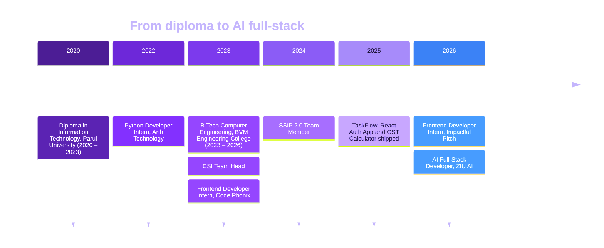

  
  
  
  

 

> **I build web apps end to end and then make them smarter.**
> Hands-on with React, Next.js, Node.js, TypeScript and Supabase, shipping authentication systems, REST APIs, real-time data workflows and responsive UI. Today my focus is on folding AI, from LLM agents to automated workflows, into full-stack products that teams actually use.

 

<table>
<tr>
<td width="33%" valign="top">

### 🛠 What I ship
- Full-stack web apps, frontend to database
- Auth: Google OAuth 2.0, Firebase, JWT sessions
- REST APIs on Node.js / Express
- Automated email and event-driven flows
- Responsive, mobile-first interfaces

</td>
<td width="33%" valign="top">

### 🤖 Where AI comes in
- LLM agents and automation workflows
- Claude and GPT wired into APIs and apps
- Document pipelines for finance and compliance
- Lead and talent scoring pipelines
- Human approval gates for anything that matters

</td>
<td width="33%" valign="top">

### 🎯 Right now
- AI Full-Stack Developer at **ZIU AI**
- Final year, B.Tech Computer Engineering
- Leading the **CSI** team at BVM
- Part of **SSIP 2.0** startup initiative
- Open to interesting automation problems

</td>
</tr>
</table>

 

 

<table>
<tr>
<td width="25%" valign="top"><b>AI Full-Stack Developer</b> ZIU AI · Present</td>
<td valign="top">Building AI agents, automations and in-house platforms: GST reconciliation, IRS Form 5471 preparation, lead and talent mining pipelines, a task manager with a nine-stage delivery pipeline, an internal learning platform, and Dot, a site-wide chatbot with voice input and streaming answers. See <a href="https://github.com/ziuai">github.com/ziuai</a>.</td>
</tr>
<tr>
<td valign="top"><b>Frontend Developer Intern</b> Impactful Pitch · Jan 2026 – Mar 2026</td>
<td valign="top">Developed and maintained live website features with React, Next.js and Tailwind CSS. Built <b>2 complete company websites</b> with modern UI/UX and full-stack Node.js, Express, MongoDB and Supabase-backed REST APIs.</td>
</tr>
<tr>
<td valign="top"><b>Frontend Developer Intern</b> Code Phonix · Dec 2023 – Jan 2024</td>
<td valign="top">Designed and developed a personal portfolio resume and a responsive login form using HTML, CSS and React. Strengthened UI layout skills through hands-on implementation of web components.</td>
</tr>
<tr>
<td valign="top"><b>Python Developer Intern</b> Arth Technology · Apr 2022 – May 2022</td>
<td valign="top">Worked with Python and PyCharm to find, connect and analyze datasets, gaining hands-on experience in data handling and scripting.</td>
</tr>
</table>

 

> AI agents, automations and in-house platforms · [github.com/ziuai](https://github.com/ziuai)

| | Project | What it does | Stack |
|---|---|---|---|
| 🧾 | **GST Reconciliation** | Reconciles GSTR-2B against the purchase register, flags mismatches and produces a vendor-wise action list every month. Live. | LLM + rules, spreadsheets, accounting exports |
| 📄 | **5471 Form** | Prepares IRS Form 5471 for foreign-corporation filings: schedule mapping, ownership tracking, validation before export. | LLM document pipeline |
| 🎯 | [**Lead Mining**](https://github.com/ziuai/candidate-mine) | Builds a qualified lead pipeline from public company data: enrich, score, route to the right owner. | AI agent, CRM APIs |
| 🧑‍💼 | [**Talent Mining**](https://github.com/ziuai/Talentmine) | Sources and shortlists candidates from public profiles and inbound applications, scored against the role brief. | AI agent |
| 🗂️ | [**UG Task Manager**](https://github.com/ziuai/taskflow-management) | Task and workflow manager with a nine-stage delivery pipeline and a single client view of progress. | Web app |
| 🎓 | [**ZIU Learn**](https://github.com/KathaZIUai/ziu-learn) | Internal learning platform: course library, structured learning paths, progress tracking and completion certificates. | Web app |
| 🤖 | **Dot, the ZIU AI assistant** | Site-wide robot mascot and chatbot: voice input, document attachments, streaming answers, page-aware actions. The same Dot you see on this page. | Astro, TypeScript, Claude API |
| 📊 | [**Unison Direct management report**](https://github.com/ziuai/unison-direct-management-report) | Upload a QuickBooks-style workbook, review a dashboard, edit values with impact analysis, export PDF or styled Excel. Optional AI explanations. | JavaScript, xlsx, jsPDF, Groq API |

 

<table>
<tr>
<td width="33%" valign="top">

### 📋 TaskFlow
**Collaborative task management platform**

Google OAuth 2.0 sign-in, a Kanban board and automated email notifications for every task event. Frontend on Vercel, backend on Railway.

`TypeScript` `React` `Node.js` `Google OAuth 2.0` `Gmail SMTP`

[**→ View repo**](https://github.com/KathaPawale/taskflow)

</td>
<td width="33%" valign="top">

### 🔐 React Auth App
**Firebase authentication with protected routes**

Firebase Google OAuth, protected dashboard routes, 24-hour session management and automatic session restoration on refresh. Deployed on Vercel.

`React` `Firebase Auth` `LocalStorage` `Vercel`

[**→ View repo**](https://github.com/KathaPawale/react-auth-app)

</td>
<td width="33%" valign="top">

### 🧮 GST Calculator
**Tax computation web tool**

Single-file tool that calculates GST across multiple tax slabs with instant results, invoice line items, totals and a print-ready preview. Deployed on Vercel.

`HTML` `CSS` `JavaScript`

[**→ View repo**](https://github.com/KathaPawale/-gst-calculator)

</td>
</tr>
</table>

 

| | |
|---|---|
| **Languages** |       |
| **Frameworks** |         |
| **Databases** | -1a1033?style=flat-square&logo=supabase&logoColor=3ecf8e)   |
| **AI & automation** |      |
| **Tools & platforms** |           |

 

Routine work passes through on its own. Anything unusual waits for a human click. Everything is logged, and results get claimed only once they have been measured.

 

<table>
<tr>
<td width="50%" valign="top">

**🎓 Education**

- **B.Tech, Computer Engineering** · 2023 – 2026 Birla Vishvakarma Mahavidyalaya (BVM) Engineering College, Anand, Gujarat
- **Diploma, Information Technology** · 2020 – 2023 Parul University, Vadodara, Gujarat

</td>
<td width="50%" valign="top">

**🏆 Awards & leadership**

- 🥉 **Vadodara Hackathon 2.0** · 2nd Runner-up
- 🥉 **Tech Expo** · 2nd Runner-up
- 👩‍💻 **CSI Team Head**, BVM Engineering College · Oct 2023 – Present Leading the Computer Society of India team in tech initiatives, workshops and events
- 🚀 **SSIP 2.0 Team Member** · Sep 2024 – Present Student Startup and Innovation Policy initiative

</td>
</tr>
</table>

 

  
  

  

 

