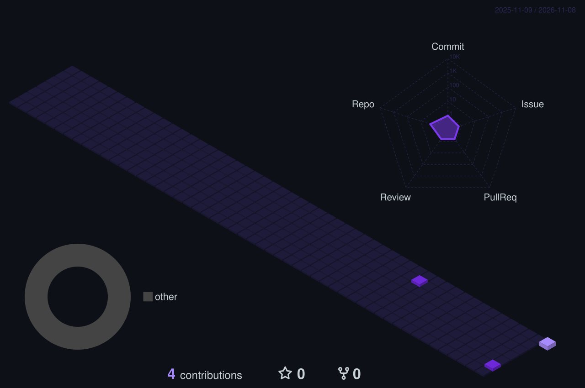

<div align="center">


<br />

[](https://github.com/KathaZIUai)
[](https://www.linkedin.com/in/REPLACE-ME)
[](mailto:squadai90@gmail.com)
[](https://github.com/ziuai)


</div>

<br />

## Hi, I'm Katha 👋

**AI Automation Developer.** I build AI-powered tools, intelligent agents and automated workflows that make everyday work more efficient. I work with LLMs such as Claude and GPT, connect them to APIs, applications and services, and ship the result as something a team can actually use.

- 🔭 Currently building **ZIU AI**: AI agents, automations and in-house platforms, with a mascot called Dot who runs the website and the chatbot
- 🧩 Favourite problems: finance and compliance workflows, lead and talent pipelines, reporting that writes itself
- 🧭 How I work: start small, keep a person approving what matters, measure before claiming results
- 💬 Ask me about: agent design, grounding LLMs in your own documents, approval gates, Zapier vs Make vs n8n vs code

<br />

## What I build

| | Project | What it does | Stack |
|---|---|---|---|
| 🧾 | **GST Reconciliation** | Reconciles GSTR-2B against the purchase register, flags mismatches, produces a vendor-wise action list every month. Live. | LLM + rules, spreadsheets, accounting exports |
| 📄 | **5471 Form** | Prepares IRS Form 5471 for foreign-corporation filings: schedule mapping, ownership tracking, validation before export. | LLM document pipeline |
| 🎯 | [**Lead Mining**](https://github.com/ziuai/candidate-mine) | Builds a qualified lead pipeline from public company data: enrich, score, route to the right owner. | AI agent, CRM APIs |
| 🧑‍💼 | [**Talent Mining**](https://github.com/ziuai/Talentmine) | Sources and shortlists candidates from public profiles and inbound applications, scored against the role brief. | AI agent |
| 🗂️ | [**UG Task Manager**](https://github.com/ziuai/taskflow-management) | Task and workflow manager with a nine-stage delivery pipeline and a single client view of progress. | Web app |
| 🎓 | [**ZIU Learn**](https://github.com/KathaZIUai/ziu-learn) | Internal learning platform: course library, structured learning paths, progress tracking and completion certificates. | Web app |
| 🤖 | **Dot, the ZIU AI assistant** | Site-wide robot mascot and chatbot: voice input, document attachments, streaming answers, page-aware actions. | Astro, TypeScript, Claude API |
| 📊 | [**Unison Direct management report**](https://github.com/ziuai/unison-direct-management-report) | Upload a QuickBooks-style workbook, review a dashboard, edit values with impact analysis, export PDF or styled Excel. Optional AI explanations. | JavaScript, xlsx, jsPDF, Groq API |
| 🧮 | [**GST calculator**](https://github.com/KathaPawale/-gst-calculator) | Browser-based GST calculator for India with invoice line items, totals and a print-ready preview. | HTML, CSS, JavaScript |
| 🔐 | [**react-auth-app**](https://github.com/KathaPawale/react-auth-app) | Firebase Google sign-in with a protected dashboard route and 24-hour session handling. | React, Firebase |

<br />

## Toolbox

<div align="center">


</div>

<br />

## How I think about automation

```text
 trigger ──▶ rules ──▶ AI reads & decides ──▶ approval gate ──▶ action ──▶ log
                                  │                 │
                      confidence score      a person decides anything
                      on every answer       customer-facing or financial
```

Routine work passes through on its own. Anything unusual waits for a human click. Everything is logged. Results get published only once they have been measured for at least four weeks.

<br />

## GitHub activity

<div align="center">


<br /><br />


<br /><br />

### 🏙️ Contribution skyline, in 3D



<sub>Rebuilt every night by a GitHub Action. Empty until the first run completes.</sub>

</div>

<br />

## Achievements and credentials

- 🏆 Hackathon winner · *event name, year and category to be added*
- 🎓 Certifications · *to be added*
- 💻 HackerRank · *profile link to be added*

<br />

<div align="center">

**Open to interesting automation problems.** If a process in your business eats hours every week, I would like to hear about it.

<sub>Built with care, measured before claimed. 🤖</sub>

</div>
